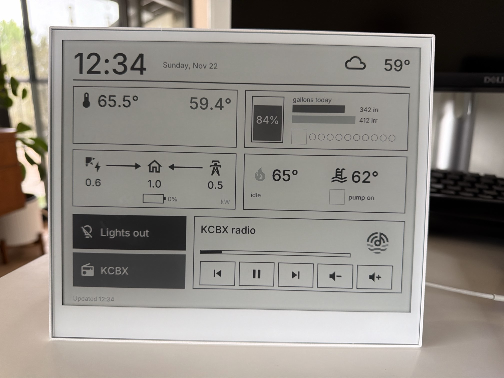
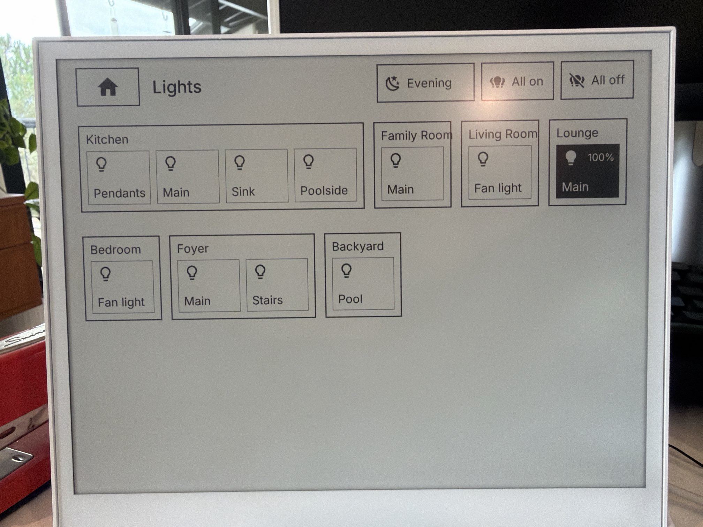

<!-- TODO(steve): one or two lines on why you wanted this in your own words. -->

I bought a [Seeed reTerminal E1003](https://www.seeedstudio.com/reTerminal-E1003-p-6731.html)
(a 10.3" touch e-paper panel with an ESP32 inside) to use with Home Assistant. Then I opened
[Claude Code](https://claude.com/claude-code) in the repo that runs my home lab and typed
roughly: *"I just got this thing. Prepare a console to use."*

A day of back-and-forth later, it looks like this:

This post is in two parts. The first part is what I did: what I bought, what I asked for, and
what I noticed along the way. The second part, below the line, is the technical detail Claude
worked out. I'm leaving that part in mostly for the next agent that gets pointed at a project
like this.

## What I bought

- **Seeed reTerminal E1003.** That's the whole hardware list for the panel itself.
- **A USB-C cable.** It's only needed for the very first flash, as long as it's actually
  plugged in. (Ask me how I know.)
- **A ratgdo32**, later, for the garage door. It's a small board that lets Home Assistant
  talk to the opener directly.

Everything else was stuff I already had: Home Assistant and a small Raspberry Pi Kubernetes
cluster, plus Sonos, Spotify, Lutron lights, the pool controller, Hydrawise irrigation, Sense,
and solar with Powerwalls.

## What I asked for

Roughly in order, and roughly in the words I used:

1. **"Prepare a console."** That meant both a place to build firmware (an ESPHome dashboard on
   my cluster) and the panel firmware itself.
2. **"Design the page."** A status board with house info at a glance.
3. **"Use the touchscreen for lights-out, and a music panel."** All lights, and the kitchen
   Sonos.
4. **"Add a button to turn KCBX on/off."** (KCBX is our local NPR station. The button doesn't
   use Sonos Radio: Home Assistant finds the station's stream through its Radio Browser
   integration and tells the kitchen Sonos to play it.) And take away the "windows
   open/closed" bar, because we already get a spoken reminder for that once a day.
5. **"Add a spot for album art / the radio logo."**
6. **"I prefer graphics to wordy."** Weather icon, temperature sparklines instead of raw
   numbers, and whatever else fits that idea.
7. **"Can we add something to HA to fetch weather predictions?"** Then a bigger date, with
   the forecast next to it.
8. **"Make all beeps simple short beeps, not multitone."**
9. **"Can we add entire new screens to flip to?"**
   - **Music:** full screen, with multiple Sonos rooms and Spotify favorites. I picked the
     layout with room grouping and an "everywhere / just here" option. Then I pasted four
     Spotify playlist links.
   - **Lights:** organized by room, with All on, All off, and an **Evening** mode that leaves
     only the kitchen pendants on at 20%. Then: "smaller buttons, group them into boxes by
     room, name each room only once." Then, from a photo: "spread things out, use up the
     space."
   - **Pool:** with buttons for the pool light colors, which is a common request at our
     house. Then: "the heaters don't do anything, remove them." And: "we're on a grayscale
     device, don't bother with colored dots."
10. **Garage door on the lights page:** status, up, down. Plus **"a 'kitty mode', which is
    15% open, can you figure that out?"** Then I stood in the garage and said "about 2x too
    far, halve it," and then "half again."
11. **"The full-screen views are hard to find. Make clear boxy buttons."**

## What I noticed along the way

My job was mostly to look at the actual panel and say what was wrong:

- **Flashing.** The first USB flash failed for a while. Then I installed the Mac USB driver it
  needed, and then I noticed the cable was unplugged.
- **"The buttons beep but don't seem to do anything."** Then: "The lights-off button works
  now, but it was super delayed, like minutes."
- **"The music widget says it's playing ZPSTR_CONNECTING."**
- **"Battery says 0%, but that's correct."** Our Powerwalls are disabled due to a recall.
- **"Clicking the music box to go to the music page restarts the playlist."**
- **"Kitty mode doesn't work."** Then: "That worked, but it's 2x too far open."
- **"5 minutes is a long time, let's speed things up."** This was about waiting on a log
  capture. After that, the checks got shorter.

Every one of these got fixed. Most of the time I didn't need to know why. The second part has
the why, in case you do.

## Where it landed

- **Main page.** The clock, date, current weather, and a 12-hour forecast. Inside and outside
  temperature with 24-hour graphs. The water tank, today's water use, and which sprinkler
  zones are running. Solar, house, and grid power. Heat and pool status. Lights out, the radio
  button, and what the kitchen speaker is playing.
- **Music, lights, and pool pages**, each one tap away. Each goes back to the main page by
  itself after 3 minutes.
- **Kitty mode.** One tap leaves the garage door open just enough for the cat.

<!-- TODO(steve): new photos of the current main, music, lights, and pool pages. -->

---

## Addendum for agents

*This part is what Claude Code worked out while building the above. It's written for the next
human or agent doing something similar.*

### Architecture

The panel is a dumb terminal, and Home Assistant holds the logic.

- **ESPHome firmware on the panel.** It subscribes to Home Assistant entities, draws four
  display `pages` (main, music, lights, pool), and turns a tap into a Home Assistant action.
- **Home Assistant packages** (`homeassistant: packages:` in `configuration.yaml`):
  - **Forecast:** a trigger-based template sensor. Every 30 minutes it calls
    `weather.get_forecasts` (`type: hourly`) and flattens six 2-hour slots into one
    attribute, `"13,rainy,57;15,rainy,55;…"`.
  - **Music:**
    - `input_select` for the selected Sonos room;
    - `sensor.panel_music`, with state, title, artist, picture, volume, and a rooms string
      `"Kitchen|playing|S;Den|idle|G;…"`;
    - a favorites sensor;
    - scripts for select, group, party, solo, transport/group volume, and favorite.
  - **Lights:** scripts for the Evening mode and All on, plus `garage_kitty_mode`.
- **Why this split:** changing favorites, rooms, or scenes takes only a `script.reload` or
  `template.reload`, which is seconds. A panel compile plus OTA update takes several minutes
  on a Pi.

### Hardware facts (reTerminal E1003)

- **Display:** IT8951 controller, 1872×1404, 16 grays. ESPHome supports it natively:
  `display: platform: it8951, model: seeed-reterminal-e1003`. Set `grayscale: true`,
  `full_update_every: 30`, and `transform: mirror_x: true`.
- **SPI:** CLK GPIO7, MOSI GPIO9, MISO GPIO8. PSRAM is octal.
- **Touch:** GT911 at I²C 0x5D on SDA GPIO19 and SCL GPIO20, interrupt GPIO2, reset GPIO48.
- **Buzzer:** GPIO45, using `ledc` plus `rtttl`. A short single beep is
  `"b:d=32,o=6,b=200:c"`.
- **Not used yet** (pins from Seeed's cookbook): buttons on GPIO3 and GPIO5, battery ADC on
  GPIO1 (enabled by GPIO40), LED on GPIO16 (inverted), SHT4x at 0x44, RTC at 0x51.
- **USB:** a CH340K serial chip. On macOS it needs the WCH DriverKit driver. Open
  `CH34xVCPDriver.app` and click Install; the legacy kernel extension gets blocked. There's no
  boot button, because esptool's auto-reset works. To flash:
  `esptool --port /dev/cu.wchusbserial* --baud 460800 write-flash 0x0 firmware.factory.bin`.

### Home Assistant setup

- **Let the device run actions.** In the ESPHome integration, enable "Allow the device to
  perform Home Assistant actions" for the device. Otherwise every `homeassistant.action`
  silently does nothing.
- **Text sensor length.** ESPHome's `homeassistant` text sensors cap at 255 characters. Pack
  compact delimited strings in Home Assistant and parse them on the device. Don't send JSON.
- **Forecasts.** Weather entities stopped exposing a `forecast` attribute in Home Assistant
  2024.3, so you have to call `weather.get_forecasts`.
- **Sonos and Spotify.** Sonos favorites were empty, and Home Assistant's Spotify
  `browse_media` returned errors. But a plain `https://open.spotify.com/playlist/<id>` link
  passed to `media_player.play_media` (`media_content_type: playlist`) plays on Sonos.
  Spotify's public oEmbed endpoint gives the playlist title for labeling.
- **Album art.** Use `online_image` with a `JPEG`, `GRAYSCALE` image, `resize` set, and
  `update_interval: never`. Set its URL to Home Assistant's base URL plus `entity_picture`,
  the proxied `/api/media_player_proxy/…?token=` path.
- **One-tap radio.** KCBX plays as
  `media-source://radio_browser/<station-uuid>` via `media_player.play_media`
  (`media_content_type: music`). The Sonos then reports the raw stream URL
  (`x-rincon-mp3radio://…/kcbx-hi`) as `media_content_id`. The button treats "playing, and the
  content ID contains `kcbx`" as on.
- **Radio placeholder titles.** Sonos reports stream titles like `ZPSTR_CONNECTING`. Map
  those, plus any known stream URLs in `media_content_id`, to a friendly name.

### Bugs and their causes

- **Taps mirrored, so buttons fired "minutes later."** Seeed's sample config puts `mirror_x`
  on both the display and the touchscreen. ESPHome's touchscreen already inherits the
  display's transform, so touch was mirrored twice and taps registered at `1872 − x`. Remove
  the touchscreen transform. To find this kind of bug, log `touch.x` and `touch.y` in
  `on_touch` and compare them with the drawn coordinates.
- **Opening a page pressed a button on it.** The finger is still down when `display.page.show`
  makes the new page's `touchscreen` binary sensors live, so the one under the finger fires
  `on_press`. Save `millis()` at every page change, and wrap every `on_press` in "only if more
  than 800 ms have passed."
- **Accented track titles.** Fonts need `glyphsets: [GF_Latin_Core]` or names like
  "Saint-Saëns" throw glyph errors.
- **Icon glyphs.** Each ESPHome font includes only the glyphs you list. An icon drawn with a
  font that doesn't list it logs `Codepoint … not found in font` and renders as an empty box.
  Look Material Design Icons codepoints up in `@mdi/svg` `meta.json`; don't guess them.
- **Inline array of sensors in a lambda.** Write `{id(a), id(b)}`, not `{&id(a), …}`.
  `id()` already returns a pointer.
- **`touchscreen` `x_max` can't be a lambda.** Precompute edges as substitutions, or generate
  the drawing code and the touch areas from the same numbers.
- **E-paper refresh storms.** A track change arrives as several updates: state, title, art,
  and volume. A restart-mode script that waits 1500 ms before `component.update` turns those
  into one refresh.

### Garage "kitty mode" (ratgdo32 on a LiftMaster 8500W, Security+ 2.0)

- **What failed:** `cover.set_cover_position` to 15 opened the door fully.
- **What works:** a Home Assistant script that:
  1. sends `open_cover`;
  2. waits until the state is `opening`, which tracks actual motion (about 1–2 s after the
     command);
  3. waits `opening_duration × target% × trim`, using ratgdo's learned duration number
     entity;
  4. sends `stop_cover`.
- **Trim:** the door coasts after stop. The trim tuned on the real door was 0.25. Coming down
  from fully open uses `close_cover` the same way, but that direction is untrimmed.

### Process notes

- **Builds and flashes:** an ESPHome dashboard pod on k3s (`ghcr.io/esphome/esphome`) builds
  the firmware. Flash with `esphome run <yaml> --device <ip> --no-logs` over OTA.
  Incremental builds took minutes on a Pi. When another compile was running at the same time,
  they took more than 10 minutes.
- **Checking a build:** grep build output case-insensitively. Invalid YAML prints `ERROR` in
  capitals and exits with code 2. Require `OTA successful` before claiming a flash worked.
- **Logs:** keep device-log checks around 60 s, streamed unbuffered to a file. Ask the human
  to tap, then read the log.
- **Before editing large generated sections** of the YAML, back the file up. Keep the touch
  rectangles and the drawing code generated from shared constants.

### Links

- [Seeed reTerminal E1003](https://www.seeedstudio.com/reTerminal-E1003-p-6731.html)
- [ESPHome](https://esphome.io/): [display](https://esphome.io/components/display/),
  [touchscreen](https://esphome.io/components/touchscreen/),
  [online_image](https://esphome.io/components/online_image/)
- [Home Assistant template integration](https://www.home-assistant.io/integrations/template/)
  and [weather](https://www.home-assistant.io/integrations/weather/)
- [Material Design Icons](https://pictogrammers.com/library/mdi/)
- [WCH CH34x macOS driver](https://github.com/WCHSoftGroup/ch34xser_macos)
- [ratgdo for ESPHome](https://github.com/ratgdo/esphome-ratgdo)
